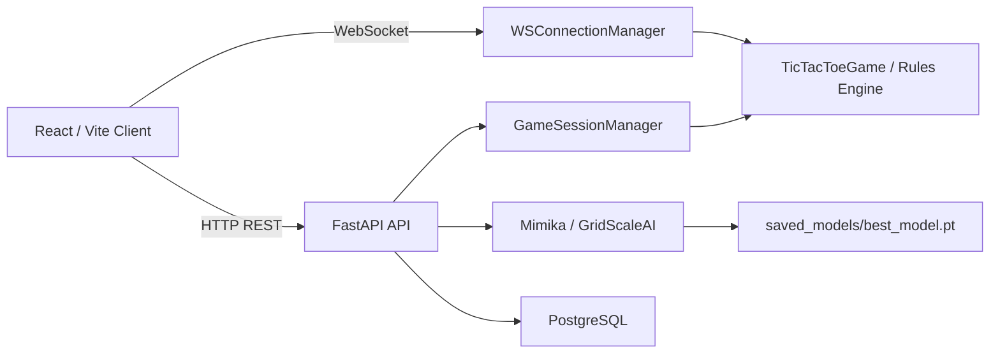

# HexTacTic

**HexTacTic** is a full-stack 6×6 Tic-Tac-Toe application built around a server-authoritative game engine, a React/Vite client, a FastAPI REST API, persistent PostgreSQL player statistics, and an optional AI opponent powered by the **Mimika** reinforcement-learning subsystem.

The application separates presentation, game-state management, AI inference, and persistence so that the browser remains a client of the game service rather than the authority over game state.

> **Scope:** This document covers the HexTacTic web application and its runtime architecture.  
> AI internals are documented in `mimika/README.md`. Database internals are documented in `about-database.md`.

---

## Architecture



The repository places the frontend in `tic-tac-toe-front/`, while the FastAPI application remains at the project root. `tic-tac-toe-front/package.json` uses `concurrently` to launch the frontend and backend development processes together.

---

## Core Design Principles

### Server-authoritative game state

The browser renders state returned by the backend. Move validation, turn management, score computation, winner detection, session management, and AI turns are performed server-side.

This prevents the client from being the source of truth for the game.

### Session-based runtime state

Active REST games are represented by UUID-backed sessions managed by `GameSessionManager`; real-time PvP games use a separate store in `ws_manager.py`. Sessions are kept in memory and protected by a re-entrant lock. Expired sessions are removed according to `SESSION_TTL_SECONDS`.

### Separate persistence from gameplay

Live game state is transient and held by the session manager. Long-lived player statistics are stored in PostgreSQL through `database.py`.

### AI as an inference service

The API does not contain the neural network implementation. It delegates AI decisions to `GridScaleAI`, which loads Mimika's trained weights and exposes a small inference interface.

---

## Runtime Components

| Component | Location | Responsibility |
|---|---|---|
| React client | `tic-tac-toe-front/src/` | UI, user interaction, state rendering |
| FastAPI application | `app.py` | REST API and application lifecycle |
| Session manager | `game_sessions.py` | Active game sessions and TTL handling |
| WebSocket manager | `ws_manager.py` | Real-time PvP sessions, join/move/broadcast, TTL purge |
| Rules engine | `script.py` | Board validation, turns, scoring and win/tie detection |
| AI service | `mimika/ai_service.py` | Model loading and move inference |
| Board encoding | `mimika/board_encoding.py` | Converts game state into model input |
| Database layer | `database.py` | PostgreSQL pooling, migrations and player statistics |
| Configuration | `settings.py` | Environment-driven runtime configuration |
| Migrations | `migrations/` | PostgreSQL schema evolution |
| Local database | `database/` | Docker Postgres (`docker-compose.yml`) and `switch-db.ps1` to switch `.env` between local and home-server presets |
| Tests | `tests/test_core.py` | Plain-assert checks for AI helpers, self-play, registry and WS messages |
| Model artifact | `saved_models/best_model.pt` | Best benchmarked Mimika parameters (the only tracked weights file) |

---

## Game Lifecycle

### 1. Application startup

FastAPI's lifespan handler:

1. Initializes the PostgreSQL layer with `init_db()`.
2. Instantiates `GridScaleAI`.
3. Loads the configured model weights into memory.
4. Keeps the AI instance available for subsequent requests.
5. Closes the PostgreSQL connection pool during application shutdown.

### 2. Starting a game

`POST /api/v1/start` accepts:

```json
{
  "mode": "vs_player",
  "difficulty": "Normal",
  "starting_player": "X"
}
```

Supported modes are:

- `vs_player` (local, same browser)
- `vs_system` (against Mimika)

Real-time PvP (`vs_player_ws` in the UI) does not use `/start`; it creates a session with `GET /api/v1/ws/create` and plays over `WS /ws`.

Supported difficulties are:

- `Easy`
- `Normal`
- `Hard`
- `Nightmare`

The backend normalizes `"Medium"` to `"Normal"` and rejects unsupported difficulty values.

A UUID session is created and the initial serialized state is returned.

### 3. Processing a move

`POST /api/v1/move`:

1. Resolves the active session.
2. Validates the requested row and column.
3. Applies the move through `TicTacToeGame`.
4. Returns the resulting state if the game has ended.
5. Otherwise, invokes Mimika when the session is a system game and the turn changes to the AI.

### 4. AI response

For an AI turn, the backend:

1. Reads the current board.
2. Computes valid flattened board indices.
3. Calls `GridScaleAI.get_best_move(...)`.
4. Converts the returned action index into `(row, col)`.
5. Applies the AI move through the same rules engine used for human moves.

### 5. Match persistence

When a `vs_system` match ends, the frontend sends the result (`win`, `loss` or `draw`) to:

```text
POST /api/v1/record-match
```

The backend validates the result and difficulty before delegating persistence to PostgreSQL.

---

## API Surface

| Method | Endpoint | Purpose |
|---|---|---|
| `GET` | `/health` | Service, database, AI readiness and model version |
| `GET` | `/metrics` | Prometheus metrics |
| `GET` | `/api/v1/state` | Retrieve an active session state |
| `POST` | `/api/v1/start` | Create a new game session |
| `POST` | `/api/v1/move` | Submit a board move |
| `GET` | `/api/v1/player/{username}` | Retrieve player statistics |
| `POST` | `/api/v1/record-match` | Persist a completed match result |
| `GET` | `/api/v1/ws/create` | Create a real-time PvP session |
| `WS` | `/ws` | Real-time PvP channel (`join`, `move`, `ping`) |

Interactive OpenAPI docs are served at `/api/v1/docs` and `/api/v1/redoc`.

The API also applies request rate limiting through `slowapi`.

In production mode, the backend can require an `X-API-Key` header. CORS origins, rate limits, runtime mode and database settings are controlled through environment configuration.

---

## Frontend

The client is a React 19 application bundled with Vite.

The frontend is responsible for:

- Game configuration.
- Username collection.
- Board rendering.
- Current-player display.
- Score and winner highlighting.
- Difficulty selection.
- Player-vs-player (local and real-time WebSocket) and player-vs-system modes.
- Move history, sound effects, keyboard board navigation and ARIA labels.
- Fetching player statistics.
- Synchronizing backend game state with React state.

The frontend package defines development commands for launching Vite and the FastAPI backend concurrently.

### Frontend stack

- React
- React DOM
- Vite
- ESLint
- `concurrently`

---

## Backend

HexTacTic uses FastAPI as the service boundary.

Important backend responsibilities include:

- Request validation through Pydantic.
- CORS configuration.
- API-key enforcement in production mode.
- Rate limiting.
- Game-session lookup and expiration handling.
- Game-rule delegation.
- AI inference delegation.
- Database access.
- Health reporting.
- Controlled production error responses.

The API is intentionally thin around the rules and model layers: `app.py` coordinates the subsystems rather than implementing the board algorithm or neural network itself.

---

## Game Engine

`script.py` contains the `TicTacToeGame` implementation.

The current implementation uses:

- A 6×6 board.
- `X` and `O` markers.
- Four directional scans:
  - horizontal
  - vertical
  - diagonal down-right
  - diagonal down-left
- Incremental score-combination detection.
- A score threshold of **3** for declaring a winner.
- Full-board detection for ties.

> **Rule summary:** every distinct 3-in-a-row line a player forms scores 1 point; the first player to 3 points wins. This is intentional (it is not a 5-in-a-row variant).

---

## Configuration

Runtime settings are centralized in `settings.py`.

Important variables include:

```text
RUNTIME_MODE
API_HOST
API_PORT
DB_NAME
DB_USER
DB_PASSWORD
DB_HOST
DB_PORT
DB_CONNECT_TIMEOUT
DB_POOL_MIN
DB_POOL_MAX
MODEL_PATH
CORS_ORIGINS
API_KEY
RATE_LIMIT
SESSION_TTL_SECONDS
```

The application can load values from a local `.env` file.

The frontend reads `VITE_API_BASE_URL` (default `http://localhost:8000/api/v1`) and `VITE_WS_BASE_URL` (default `ws://localhost:8000/ws`).

The model path defaults to:

```text
saved_models/best_model.pt
```

Set `MODEL_PATH` to serve a different weights file. Training output (`saved_models/dqn_model_weights.pth`, registry checkpoints) is gitignored; promote a new model by benchmarking it against `best_model.pt` and copying the winner over it.

---

## Installation

### Prerequisites

- Python 3.10+
- Node.js
- npm
- PostgreSQL (or Docker, to run the bundled local Postgres)
- PyTorch and the Python dependencies required by the backend
- A trained Mimika weight file for AI gameplay

### Backend environment

Create the virtual environment `npm run dev` expects and install the Python dependencies:

```bash
python -m venv .venv
.venv\Scripts\pip install -r requirements.txt
```

### Database

Database secrets live only in the gitignored root `.env`. Add them once:

```env
LOCAL_DB_PASSWORD=choose_a_local_password
HOMESERVER_DB_HOST=your_home_server_ip
HOMESERVER_DB_PASSWORD=your_home_server_password
```

Start the local Postgres container (host port 5433) and point `.env` at it:

```powershell
docker compose --env-file .env -f database/docker-compose.yml up -d
.\database\switch-db.ps1 local        # or: homeserver
```

`switch-db.ps1` rewrites only the `DB_*` lines of `.env` from `database/presets/`. A preset value like `${HOMESERVER_DB_PASSWORD}` is filled in from `.env`, so presets are safe to commit. Tables are created by the API's migrations on startup.

To configure `.env` by hand instead, create it in the repository root.

Example:

```env
DB_NAME=postgres
DB_USER=postgres
DB_PASSWORD=your_password
DB_HOST=127.0.0.1
DB_PORT=5432

RUNTIME_MODE=development
API_PORT=8000
```

### Install frontend dependencies

```bash
cd tic-tac-toe-front
npm install
```

### Run development environment

From the frontend directory:

```bash
npm run dev
```

The repository's frontend package launches:

- Vite for the React client.
- Uvicorn for the FastAPI backend (from `.venv`).

### Run tests

```bash
.venv\Scripts\python.exe tests/test_core.py
```

---

## Repository Structure

```text
./
├── app.py
├── database.py
├── game_sessions.py
├── script.py
├── settings.py
├── ws_manager.py
├── requirements.txt
├── about-database.md
├── database/
│   ├── docker-compose.yml
│   ├── switch-db.ps1
│   └── presets/
├── tests/
│   └── test_core.py
├── migrations/
│   ├── 001_initial.sql
│   └── 002_backfill_highest_difficulty.sql
├── mimika/
│   ├── README.md
│   ├── __init__.py
│   ├── agent.py
│   ├── ai_service.py
│   ├── board_encoding.py
│   ├── config.py
│   ├── model.py
│   ├── trainer.py
│   ├── trainer_enhanced.py
│   ├── model_registry.py
│   └── evaluate.py
├── saved_models/
│   └── best_model.pt
├── tic-tac-toe-front/
│   ├── src/
│   │   ├── App.jsx
│   │   └── App.css
│   ├── package.json
│   └── ...
└── package.json
```

---

## Security and Reliability

HexTacTic includes several service-level safeguards:

- API-key enforcement for production deployments.
- Configurable CORS.
- Request rate limiting.
- Pydantic request validation.
- Bounded board coordinates.
- Session expiration.
- Thread-safe in-memory session access.
- PostgreSQL connection pooling.
- Parameterized database queries.
- Generic internal-server errors in production mode.

Secrets such as database passwords and API keys should remain outside source control.

---

## Related Documentation

- `mimika/README.md` — reinforcement-learning model, training pipeline and inference architecture.
- `about-database.md` — PostgreSQL schema, migration system, connection pooling and persistence model.

---

## Current Implementation Notes

The architecture diagrams describe the intended subsystem boundaries, while the repository source is authoritative for current behavior.

The live AI implementation is contained in `mimika/`, and persistence uses PostgreSQL.

Known gaps: the frontend does not send `X-API-Key`, so production mode with `API_KEY` set rejects its requests; a second player cannot yet join a WebSocket game from the UI; WebSocket games skip API-key auth and are not recorded.

## License

HexTacTic is licensed under the MIT License.

See the [LICENSE](./LICENSE.txt) file for details.